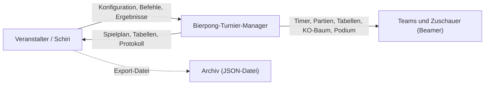
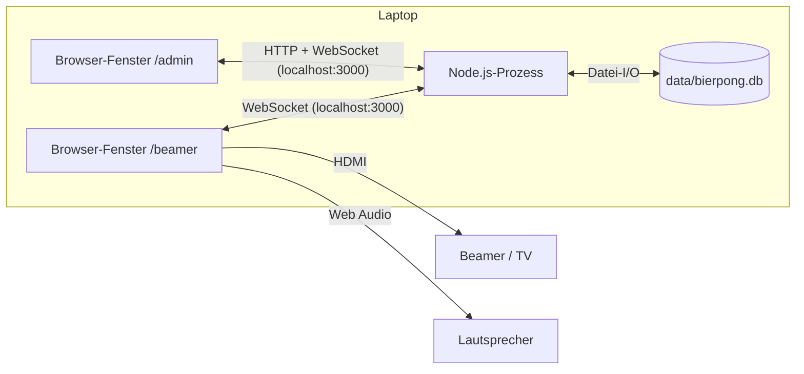
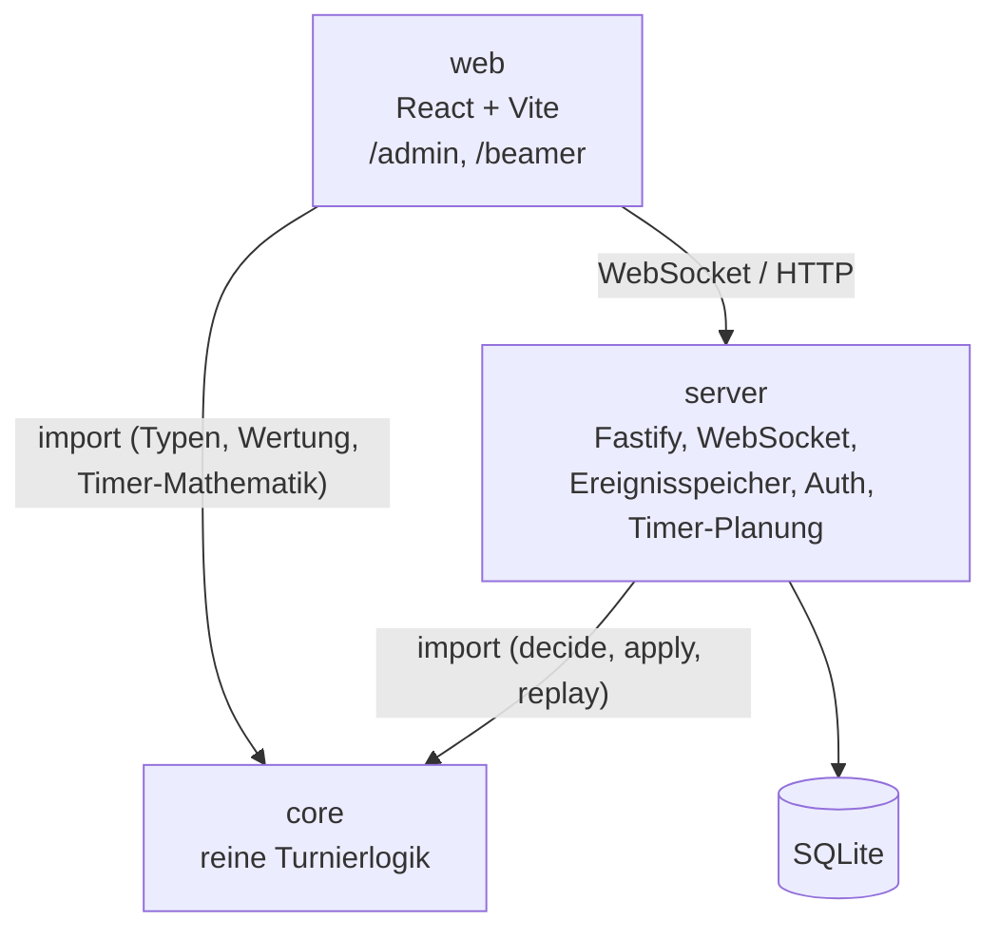
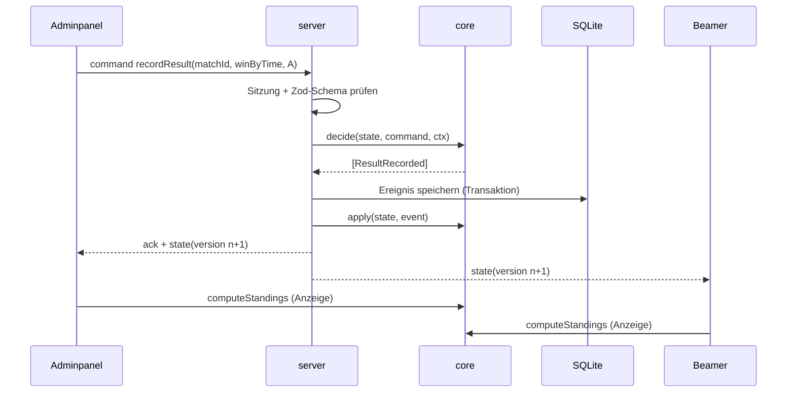
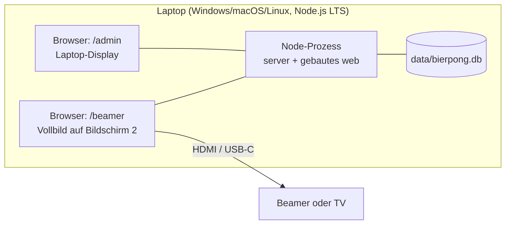

# 

**Über arc42**

arc42, das Template zur Dokumentation von Software- und
Systemarchitekturen.

Template Version 9.2-DE. (basiert auf der AsciiDoc Version), Oktober
2026

Created, maintained and © by Dr. Peter Hruschka, Dr. Gernot Starke and
contributors. Siehe <https://arc42.org>.

Stand dieser Dokumentation: 06.11.2026. Grundlage: Pflichtenheft, Architekturdokument und Startpaket für Claude Code (`docs/SPEC.md`, `docs/ARCHITECTURE.md`, `docs/adr/README.md`).

# Einführung und Ziele {#section-introduction-and-goals}

## Aufgabenstellung {#_aufgabenstellung}

Der Bierpong-Turnier-Manager ist eine lokal gehostete Web-Anwendung, mit der ein Veranstalter ein Bierpong-Turnier mit mehreren gleichzeitig bespielten Tischen planen, steuern und auf einem Beamer präsentieren kann.

Wesentliche Features (Details und IDs in `docs/SPEC.md`):

| Bereich | Kern |
|---|---|
| Turnierverwaltung | Mehrere Turniere anlegen, speichern, wieder öffnen, exportieren (M01, S07) |
| Teams und Tische | Teams mit flexibler Spielerzahl, Tischanzahl frei, Tische nur nummeriert (M02, M03) |
| Modus | Gruppenphase + KO oder nur KO (M04) |
| Gruppenphase | Gruppenanzahl 2^k, Zuteilung per Panel oder Zufall, jeder gegen jeden, Punkte 3/2/1/0, Tiebreaker mit Begründung (M05–M10) |
| KO-Phase | Über-Kreuz-Setzung, Freilose zufällig, Gleichstand nach Zeit: nächster Becher gewinnt, optional Platz 3 (M11, M14, S04) |
| Ablauf | Partien automatisch auf Tische und Durchgänge verteilt, ein globaler Timer pro Durchgang, Admin startet jeden Durchgang (M12, M13, M15, M16) |
| Ansichten | Adminpanel mit Passwort; Beamer-Ansicht ohne Bedienelemente, Modi Rotation und Fest, live synchronisiert (M17, M18, S06) |
| Nachvollziehbarkeit | Rückgängig und Änderungsprotokoll (M19, M20) |

## Qualitätsziele {#_qualitätsziele}

| Prio | Qualitätsziel (ISO 25010) | Motivation |
|---|---|---|
| 1 | **Zuverlässigkeit** – kein Datenverlust, Wiederanlauf | Ein Absturz mitten im Turnier darf Spielstand und Timer nicht kosten. |
| 2 | **Funktionale Korrektheit** – Wertung und Tiebreaker nachvollziehbar | Über Gleichstände wird am Turnierabend gestritten; die App muss richtig rechnen und ihre Begründung zeigen. |
| 3 | **Zeitverhalten** – Echtzeit-Synchronisation | Beamer und Adminpanel müssen innerhalb einer Sekunde denselben Stand und denselben Timer zeigen. |
| 4 | **Benutzbarkeit** – schnelle Bedienung unter Partybedingungen | Ergebnis in höchstens zwei Klicks, Beamer aus fünf Metern lesbar. |
| 5 | **Wartbarkeit** – testbare, klar getrennte Logik | Einzelentwickler mit KI-Unterstützung; Regeln müssen isoliert testbar und erweiterbar sein (LAN, mobile Schiris). |

## Stakeholder {#_stakeholder}

| Rolle | Kontakt | Erwartungshaltung |
|---|---|---|
| Veranstalter / Admin | Daniel | Turnier ohne Zettelwirtschaft durchführen; schnelle Einrichtung, verlässlicher Ablauf, Korrekturen jederzeit möglich |
| Schiedsrichter | Person am Laptop (in Version 1.0 identisch mit Admin) | Ergebnisse schnell eintragen, Timer bedienen, Fehler rückgängig machen |
| Teams / Spieler | – (keine Systemnutzer) | Fairer Spielplan, nachvollziehbare Tabelle, klar sichtbar, an welchem Tisch sie spielen |
| Zuschauer | – (sehen nur den Beamer) | Gut lesbarer Spielstand, Timer, KO-Baum |
| Entwickler | Daniel mit Claude Code | Eindeutige Vorgaben (SPEC, Architekturregeln, DESIGN.md), Kontrollpunkte, testbarer Code |

# Randbedingungen {#section-architecture-constraints}

**Technisch**

| Randbedingung | Erläuterung |
|---|---|
| Lokaler Betrieb auf einem Gerät | Kein Internet erforderlich; Server, Datenbank und beide Ansichten auf einem Laptop (ADR 001) |
| Persistenz in SQLite | Eine Datei, keine Datenbankinstallation (ADR 002) |
| Start per `npm start` | Einzige Voraussetzung: Node.js LTS |
| Plattformen | Windows, macOS, Linux; aktuelle Chromium-Browser und Firefox |
| Stack | TypeScript, React + Vite, Fastify, WebSocket, Drizzle; kein Next.js (ADR 014–018) |

**Organisatorisch**

| Randbedingung | Erläuterung |
|---|---|
| Entwicklung durch eine Person mit Claude Code | Arbeitsregeln in `CLAUDE.md`, Kontrollpunkte über `.claude/settings.json` |
| Gestaltung nach `DESIGN.md` | Wird vom Projekt beigesteuert und hat Vorrang vor Plugin-Vorgaben |
| Kein Budget für Hosting | Internet-Hosting ist Kann-Ziel (K04) |

**Konventionen**

| Konvention | Erläuterung |
|---|---|
| Sprache | UI und Doku Deutsch, Code und Commits Englisch |
| Architekturentscheidungen | Als ADR in `docs/adr/` |
| Commits | Conventional Commits mit Anforderungs-IDs, z. B. `feat(core): tiebreaker chain (M09)` |

# Kontextabgrenzung {#section-context-and-scope}

## Fachlicher Kontext {#_fachlicher_kontext}

| Partner | Eingabe an das System | Ausgabe vom System |
|---|---|---|
| Veranstalter / Schiri | Turnier, Teams, Tische, Gruppen, Durchgangsstart, Timer-Befehle, Ergebnisse, Stechen, Rückgängig, Beamer-Steuerung | Adminpanel mit Spielplan, Tabellen, Protokoll, Warnungen |
| Teams und Zuschauer | – (nur Betrachter) | Beamer-Ansichten: Timer + Partien je Tisch, Gruppentabellen mit Platzierungsgrund, KO-Baum, nächste Spiele, Podium; Tonsignale |
| Archiv | – (Import erst K06) | Export eines Turniers als JSON |

## Technischer Kontext {#_technischer_kontext}

| Schnittstelle | Technik | Inhalt |
|---|---|---|
| Admin ↔ Server | HTTP (Login, Turnierliste, Export), WebSocket (Befehle, Zustand) | JSON, Zod-validiert |
| Beamer ↔ Server | WebSocket, nur lesend | Vollständiger Zustand mit Version, Timer-Signale |
| Server ↔ Dateisystem | better-sqlite3 | Ereignisse, Turniere, optionale Snapshots |
| Beamer → Ausgabegeräte | Zweiter Bildschirm, Web Audio | Bild und Signaltöne |

**Mapping fachlich → technisch:** Befehle des Schiris laufen als `command`-Nachricht über den WebSocket; alle Ausgaben an Admin und Publikum sind derselbe `state`-Broadcast, nur unterschiedlich dargestellt. Export läuft über `GET /api/tournaments/:id/export`.

# Lösungsstrategie {#section-solution-strategy}

| Qualitätsziel | Lösungsansatz | Entscheidung |
|---|---|---|
| Zuverlässigkeit | Ereignisspeicher in SQLite, jede Änderung sofort in einer Transaktion; Zustand wird beim Start durch Abspielen wiederhergestellt; Timer als Zeitstempel statt laufender Zähler | ADR 002, 004, 019 |
| Korrektheit | Gesamte Turnierlogik als reines Paket `core` mit Tabellentests; Tabellen werden immer berechnet, nie gespeichert; Platzierungsgrund wird mitgeliefert | ADR 006, 012 |
| Nachvollziehbarkeit | Rückgängig als Gegenereignis, nichts wird gelöscht; Zufall wird ins Ereignis geschrieben | ADR 011, 021 |
| Zeitverhalten | WebSocket-Push des vollständigen Zustands; Clients rechnen Timer selbst aus Serverwerten | ADR 003, 017, 020 |
| Benutzbarkeit | Zwei getrennte Ansichten für zwei Rollen; Beamer ohne Bedienelemente, Rotation oder feste Ansicht | ADR 001, S06 |
| Wartbarkeit | TypeScript-Monorepo mit klaren Abhängigkeitsregeln (`web → core`, `server → core`); Zod-Schemas als gemeinsamer Vertrag | ADR 014, 022 |
| Einfacher Betrieb | Ein Prozess, ein Port, keine externe Infrastruktur | ADR 023 |

# Bausteinsicht {#section-building-block-view}

## Whitebox Gesamtsystem {#_whitebox_gesamtsystem}

Begründung

:   Die Fachlogik ist der fehleranfälligste und am meisten umstrittene Teil. Sie liegt deshalb isoliert in `core` ohne I/O, damit sie vollständig testbar ist und Server und Browser dieselben Regeln verwenden. Der Server ist die einzige Stelle, die den Zustand verändert.

Enthaltene Bausteine

:   `core` (Domäne, Befehle, Ereignisse, Regeln), `server` (Infrastruktur und Orchestrierung), `web` (Darstellung und Eingabe).

Wichtige Schnittstellen

:   Öffentliche API von `core` (`decide`, `apply`, `replay`, `computeStandings`, Generatoren, Timer-Funktionen, Zod-Schemas); WebSocket-Protokoll zwischen `web` und `server`.

### core {#_name_blackbox_1}

*Zweck/Verantwortung:* Alle Turnierregeln: Spielplan, Verteilung auf Tische und Durchgänge, Wertung, Tiebreaker, KO-Baum, Freilose, Timer-Mathematik, Validierung von Befehlen, Erzeugen und Anwenden von Ereignissen, Rückgängig.

*Schnittstellen:* `decide(state, command, ctx) → Result<DomainEvent[], DomainError>`, `apply(state, event) → state`, `replay(events) → state`, `computeStandings(state, groupId)`, Zod-Schemas für `Command` und `DomainEvent`.

*Qualitätsmerkmale:* Deterministisch, frei von I/O, `Date.now()` und `Math.random()`; Testabdeckung ≥ 90 %.

*Ablageort:* `packages/core/`

*Erfüllte Anforderungen:* M05–M16, M19, S01–S04.

*Offene Punkte/Risiken:* Tiebreaker bei Kreisvergleichen mit mehr als zwei Teams (siehe Risiken).

### server {#_name_blackbox_2}

*Zweck/Verantwortung:* Nimmt Befehle an, prüft Sitzung, ruft `core` auf, speichert Ereignisse transaktional, hält den Zustand je Turnier im Speicher, verteilt ihn an alle Clients, plant Timer-Signale, liefert das Frontend aus.

*Schnittstellen:* HTTP-API (`/api/login`, `/api/tournaments`, `/api/tournaments/:id/export`), WebSocket `/ws` (Protokoll siehe Querschnittliche Konzepte), SQLite.

*Qualitätsmerkmale:* Wiederanlauf ohne Datenverlust; Broadcast < 1 s.

*Ablageort:* `packages/server/`

*Erfüllte Anforderungen:* M01, M17, M18, M20, M21, S07, N01–N05.

### web {#_name_blackbox_n}

*Zweck/Verantwortung:* Adminpanel zur Einrichtung und Steuerung, Beamer-Ansicht zur Präsentation. Spiegelt den Serverzustand, sendet Befehle, rechnet Timer-Anzeige lokal.

*Schnittstellen:* Routen `/admin`, `/beamer`; WebSocket-Client.

*Qualitätsmerkmale:* Ergebnis in ≤ 2 Klicks; Beamer lesbar aus 5 m; Gestaltung nach `DESIGN.md`.

*Ablageort:* `packages/web/`

*Erfüllte Anforderungen:* M03, M05, M13, M17–M19, S02, S03, S05, S06, N07, N08.

### WebSocket-Protokoll {#_name_schnittstelle_1}

Nachrichten `hello`, `command` (Client → Server) und `state`, `ack`, `error`, `timer`, `tick` (Server → Client). Details in Abschnitt Querschnittliche Konzepte.

## Ebene 2 {#_ebene_2}

### Whitebox *core* {#_whitebox_baustein_1}

| Baustein | Verantwortung |
|---|---|
| `domain/` | Typen: Tournament, Team, Table, Group, Round, Heat, Match, Settings, TournamentState |
| `commands/` | Zod-Schema + Typ je Befehl, Union `Command` |
| `events/` | Zod-Schema + Typ je Ereignis mit Version `v`, Union `DomainEvent` |
| `decide.ts` | Fachliche Prüfung eines Befehls, erzeugt Ereignisse |
| `apply.ts` / `replay.ts` | Reiner Reducer; Abspielen unter Auslassung aufgehobener Ereignisse |
| `schedule/` | Rundenturnier (Circle-Methode), Verteilung auf Tische und Durchgänge |
| `bracket/` | KO-Baum, Über-Kreuz-Setzung, Freilose |
| `standings/` | Tabelle, Tiebreaker-Kette mit `rankReason` |
| `timer/` | Restzeit, Warnstufen |
| `undo/` | Ermittlung abhängiger späterer Ereignisse |

### Whitebox *server* {#_whitebox_baustein_2}

| Baustein | Verantwortung |
|---|---|
| `db/` | Drizzle-Schema, Client, Migrationen |
| `store/eventStore.ts` | Anhängen mit lückenloser Sequenz, Laden je Turnier |
| `store/tournamentRegistry.ts` | Zustand der geöffneten Turniere im Speicher |
| `commands/handle.ts` | Auth → Validierung → `decide` → speichern → `apply` → Broadcast |
| `ws/` | Protokoll-Schemas, Verbindungs-Hub je Turnier |
| `http/` | Login, Turnierliste, Export |
| `auth/` | scrypt-Hash, Session-Cookie |
| `timer/scheduler.ts` | Vorwarnungen und Ablauf planen, nach Neustart neu planen |

### Whitebox *web* {#_whitebox_baustein_m}

| Baustein | Verantwortung |
|---|---|
| `shared/ws/` | Verbindung, Reconnect, `send(command)` |
| `shared/store/` | Zustand-Store mit Zustand, Version, Serverzeit-Offset |
| `shared/hooks/useRemaining` | Timer-Anzeige 4× pro Sekunde |
| `shared/i18n/de.ts` | Alle UI-Texte |
| `shared/ui/` | Basiskomponenten nach `DESIGN.md` |
| `admin/` | Seiten: Login, Turnierliste, Einrichtung, Gruppen-Panel, Spielplan, Ergebnisse, Beamer-Steuerung, Protokoll, Einstellungen |
| `beamer/` | Modus Rotation/Fest; Ansichten Timer, Tabellen, KO-Baum, nächste Spiele, Podium; Audio |

## Ebene 3 {#_ebene_3}

Für Version 1.0 nicht nötig. Die Module der Ebene 2 sind klein genug, um sie direkt im Code zu verstehen. Ebene 3 wird ergänzt, falls `standings/` oder `bracket/` deutlich wachsen.

# Laufzeitsicht {#section-runtime-view}

## Ergebnis erfassen {#_bezeichnung_laufzeitszenario_1}

- Fachliche Fehler (z. B. Unentschieden im KO) gehen nur als `error` an den Absender zurück; nichts wird gespeichert.
- Tabellen werden in beiden Clients aus dem Zustand berechnet, nicht übertragen.

## Durchgang starten und Timer {#_bezeichnung_laufzeitszenario_2}

1. Admin sendet `startHeat`. `core` prüft, dass die vorige Partie-Belegung des Tisches beendet ist, und erzeugt `HeatStarted` mit `startedAt` und `durationMs` aus den Einstellungen der Phase (bei Halbfinale/Finale `null`).
2. Server speichert, sendet `state` und plant per `setTimeout` die Vorwarnungen (Standard 5 min, 1 min, 30 s) und den Ablauf.
3. Clients berechnen die Restzeit selbst; der Beamer zeigt Warnstufen und spielt bei freigegebenem Ton Signale.
4. Pause, Fortsetzen, Verlängern, Neustart sind Befehle; der Scheduler plant nach jedem neu.
5. Bei Ablauf sendet der Server `timer: expired`. Unentschiedene KO-Partien werden nach „nächster Becher gewinnt“ mit Sieger erfasst.

## Rückgängig {#_bezeichnung_laufzeitszenario_n}

1. Admin wählt „Rückgängig“ (letzte Aktion) oder einen Eintrag im Protokoll.
2. `core/undo` prüft, ob spätere Ereignisse davon abhängen (z. B. eine KO-Partie mit dem bisherigen Sieger). Wenn ja, erhält der Admin eine Warnung und muss bestätigen.
3. `core` erzeugt `Undone(targetId)`; der Server speichert und spielt alle Ereignisse ohne die aufgehobenen erneut ab.
4. Neuer Zustand geht an alle Clients. Ein `Undone` auf ein `Undone` stellt das Ereignis wieder her.

## Wiederanlauf nach Absturz oder Neustart

1. Server startet, wendet ausstehende Migrationen an.
2. Beim ersten `hello` für ein Turnier lädt er alle Ereignisse und spielt sie über `replay` ab.
3. Läuft ein Durchgang, plant der Scheduler die verbleibenden Signale aus `startedAt`, `pausedAt`, `pausedTotalMs` neu.
4. Clients verbinden sich automatisch neu (Backoff 0,5 s bis 5 s) und erhalten den aktuellen Zustand.

## Übergang Gruppenphase → KO

1. Nach dem letzten Gruppenergebnis prüft `core`, ob alle Tabellen eindeutig sind. Bei `needsPlayoff` zeigt das Adminpanel die Stechen an; erst nach `PlayoffRecorded` geht es weiter.
2. Admin bestätigt den Übergang; `core` erzeugt `PhaseAdvanced` mit dem fertigen KO-Baum (Über-Kreuz-Setzung, Freilose als Werte).
3. Der Beamer zeigt im Rotationsmodus ab jetzt den KO-Baum statt der Gruppentabellen.

# Verteilungssicht {#section-deployment-view}

## Infrastruktur Ebene 1 {#_infrastruktur_ebene_1}

Begründung

:   Turniere finden oft ohne verlässliches Netz statt. Ein einziger Rechner vermeidet jede Netzwerkkonfiguration. Der Server bindet standardmäßig an `127.0.0.1`.

Qualitäts- und/oder Leistungsmerkmale

:   Ausgelegt für bis zu 64 Teams und 16 Tische; Ereignisse pro Turnier unter 2.000; Zustand unter 100 KB.

Zuordnung von Bausteinen zu Infrastruktur

:   `server` und das gebaute `web` laufen im Node-Prozess; `core` ist in beide gebündelt; SQLite-Datei im Projektordner `data/`.

## Infrastruktur Ebene 2 {#_infrastruktur_ebene_2}

### Entwicklungsumgebung {#_infrastrukturelement_1}

`npm run dev` startet Fastify (Port 3000, Neustart bei Änderungen) und den Vite-Dev-Server (Port 5173). Vite leitet `/api` und `/ws` an Fastify weiter.

### Ausblick LAN-Betrieb (K01) {#_infrastrukturelement_2}

Server bindet an `0.0.0.0`; Schiri-Handys verbinden sich über das WLAN. Erfordert keinen Umbau, aber Mehrbenutzer-Sitzungen und konkurrierende Eingaben (eigenes ADR).

# Querschnittliche Konzepte {#section-concepts}

## Fachliches Modell {#_konzept_1}

Turnier → Gruppen → Runden → Durchgänge → Partien; Teams mit Spielern; Tische nur als Nummern. Punkte nur in der Gruppenphase (Sieg 3, Sieg durch Zeit 2, Unentschieden 1, Niederlage 0, Freilos 0); gewertet wird die Gesamtpunktzahl. Vollständige Regeln in `docs/SPEC.md`.

## Ereignisspeicher und Persistenz {#_konzept_2}

- Einzige Wahrheit sind die Ereignisse (`events`-Tabelle, lückenlose `seq` pro Turnier).
- Zustand = `replay(events)`; Tabellen und Platzierungen werden nie gespeichert.
- Ereignistypen tragen eine Version `v`; Schemaänderungen über drizzle-kit-Migrationen beim Start.
- SQLite im WAL-Modus für Robustheit bei Stromausfall.

## Rückgängig und Protokoll

Rückgängig erzeugt `Undone`; nichts wird gelöscht. Das Protokoll im Adminpanel ist eine Ansicht auf die Ereignisse (Zeit, Typ, Ziel, alter/neuer Wert, aufgehoben).

## Determinismus und Zufall

`core` erhält Zeit, Zufall und IDs über einen Kontext vom Server. Ausgeloste Gruppen und Freilose werden als Ergebnis ins Ereignis geschrieben, damit Abspielen immer dasselbe Turnier ergibt und Tests mit festen Seeds reproduzierbar sind.

## Echtzeit-Synchronisation

Nach jeder Änderung sendet der Server den vollständigen Zustand mit Versionsnummer an alle Clients. Clients verbinden sich automatisch neu. Der Beamer sendet niemals Befehle.

## Timer

Gespeichert werden nur `durationMs`, `startedAt`, `pausedAt`, `pausedTotalMs`. Restzeit = Dauer − (jetzt − Start − Pausen). Der Serverzeit-Offset wird über `state` und `tick` abgeglichen. Signale plant der Server und sendet sie als nicht persistierte `timer`-Nachricht.

## Validierung und Fehlerbehandlung

Alle Befehle und WebSocket-Nachrichten werden mit Zod geprüft. Fachliche Fehler liefert `core` als `Result` mit `DomainError`, keine Exceptions. Der Client zeigt Fehlermeldungen aus `de.ts`.

## Sicherheit

Ein Passwort pro Turnier, gespeichert als scrypt-Hash; Sitzung als HTTP-only-Cookie mit `SameSite=Strict`. Server nur auf `localhost`. Beamer braucht kein Login, sieht aber nur lesend den Zustand.

## Darstellung und Sprache

Gestaltung ausschließlich nach `DESIGN.md`. Beamer auf 1920 × 1080 optimiert, hoher Kontrast, lesbar aus 5 m. Alle Texte zentral in `de.ts`. Der Beamer fordert eine Bildschirm-Wachhaltung (Screen Wake Lock) an, damit er nicht in den Ruhemodus geht.

## Testkonzept

| Ebene | Werkzeug | Fokus |
|---|---|---|
| Unit | Vitest | `core`: alle Regeln als Tabellentests mit festen Seeds |
| Integration | Vitest + In-Memory-SQLite | Befehl → Ereignis → Broadcast; Wiederanlauf |
| Komponente | Vitest + Testing Library | Ergebniseingabe, Gruppen-Panel, Timer-Anzeige |
| E2E | Playwright | Ganzes Turnier, beide Modi, zweiter Browser-Kontext als Beamer |

## Entwicklung mit Claude Code

`CLAUDE.md` legt Pflichtlektüre, Architekturregeln, Konventionen und Kontrollpunkte fest. Zustimmungspflichtig sind neue Pakete, `package.json` sowie Spezifikation, Architektur und ADRs; `git push` ist gesperrt. Plugins: typescript-lsp, context7, playwright, commit-commands, ponytail (nicht `ultra`). Architekturregeln haben Vorrang vor Plugin-Vorgaben.

# Architekturentscheidungen {#section-design-decisions}

Alle Entscheidungen sind in `docs/adr/README.md` festgehalten. Überblick:

| Nr | Entscheidung | Bezug |
|---|---|---|
| 001 | Lokales Hosting auf einem Gerät | Randbedingungen |
| 002 | SQLite | Zuverlässigkeit |
| 003 | Echtzeit per Server-Push | Zeitverhalten |
| 004 | Globaler Timer pro Durchgang, serverseitig als Zeitstempel | Zuverlässigkeit |
| 005 | Punkte 3/2/1/0 | Fachlich |
| 006 | Tiebreaker: direkter Vergleich → Becherdifferenz → Stechen | Korrektheit |
| 007 | Becherdifferenz optional | Benutzbarkeit |
| 008 | Gruppen = 2^k, Freilose bei Lücken, Gesamtpunktzahl | Fachlich |
| 009 | KO über Kreuz, Freilose zufällig | Fachlich |
| 010 | KO-Gleichstand: nächster Becher gewinnt; HF/Finale ohne Limit | Fachlich |
| 011 | Rückgängig über Ereignisprotokoll | Nachvollziehbarkeit |
| 012 | Tabellen werden berechnet | Korrektheit |
| 013 | Ein Passwort pro Turnier, ein Schiri pro Gerät | Sicherheit |
| 014 | TypeScript-Monorepo | Wartbarkeit |
| 015 | React + Vite statt Next.js | Wartbarkeit |
| 016 | Fastify | Einfacher Betrieb |
| 017 | Rohe WebSockets statt Socket.IO | Zeitverhalten |
| 018 | Drizzle + better-sqlite3 | Wartbarkeit |
| 019 | Ereignisspeicher als einzige Quelle | Zuverlässigkeit |
| 020 | Vollständiger Zustand statt Diffs | Zeitverhalten |
| 021 | Zufall im Ereignis speichern | Korrektheit |
| 022 | Zod für Befehle | Wartbarkeit |
| 023 | Ein Prozess, ein Port | Einfacher Betrieb |

# Qualitätsanforderungen {#section-quality-scenarios}

## Übersicht der Qualitätsanforderungen {#_übersicht_der_qualitätsanforderungen}

| Qualitätsmerkmal | Anforderungen |
|---|---|
| Zuverlässigkeit | N03 Wiederanlauf ohne Verlust, N04 sofortige Persistenz |
| Korrektheit | M08–M11, M14 Regeln; N11 getestete Logik |
| Zeitverhalten | N01 Sync < 1 s, N02 Timer-Abweichung < 0,5 s, N06 64 Teams / 16 Tische |
| Benutzbarkeit | N07 Lesbarkeit Beamer, N08 Ergebnis ≤ 2 Klicks, N10 deutsche UI |
| Sicherheit | N09 Passwort nur als Hash |
| Wartbarkeit / Erweiterbarkeit | N11 core ohne UI, N12 LAN ohne Umbau |
| Installierbarkeit | N05 Start mit einem Befehl |

## Qualitätsszenarien {#_qualitätsszenarien}

| ID | Merkmal | Situation | Erwartete Reaktion | Messgröße |
|---|---|---|---|---|
| QS-1 | Zuverlässigkeit | Laptop stürzt während eines laufenden Durchgangs ab | Nach Neustart sind alle Ergebnisse da, Timer läuft mit korrekter Restzeit weiter | 0 verlorene Ereignisse; Timer-Abweichung < 1 s |
| QS-2 | Zuverlässigkeit | Beamer-Fenster wird versehentlich neu geladen | Ansicht ist sofort wieder vollständig da | < 2 s bis zur vollständigen Anzeige |
| QS-3 | Korrektheit | Drei Teams einer Gruppe sind punktgleich und haben sich im Kreis geschlagen | Tabelle zeigt „Stechen nötig“ bzw. Becherdifferenz als Grund; KO startet erst nach Auflösung | 100 % der definierten Regelfälle in Tests grün |
| QS-4 | Korrektheit | Schiri korrigiert ein Gruppenergebnis, nachdem das KO schon begonnen hat | Warnung mit Liste betroffener Partien; erst nach Bestätigung wirksam | Keine stillen Folgeänderungen |
| QS-5 | Zeitverhalten | Schiri trägt ein Ergebnis ein | Beamer zeigt neue Tabelle | < 1 s |
| QS-6 | Zeitverhalten | Admin pausiert den Timer | Beamer zeigt Pause | < 0,5 s Abweichung |
| QS-7 | Benutzbarkeit | Schiri trägt „Sieg durch Zeit“ für Team A ein | Erfassung ohne Tastatur | ≤ 2 Klicks |
| QS-8 | Benutzbarkeit | Zuschauer in 5 m Entfernung | Kann Tischnummer, Teams und Restzeit lesen | Schriftgröße nach DESIGN.md, Prüfung vor Ort |
| QS-9 | Wartbarkeit | Neue Tiebreaker-Regel soll ergänzt werden | Änderung nur in `core/standings` plus Tests | Kein Code in server/web nötig |
| QS-10 | Erweiterbarkeit | LAN-Zugriff für Schiri-Handys wird aktiviert | Nur Konfiguration und Mehrbenutzer-Sitzungen | Kein Umbau von Protokoll oder Ereignisspeicher |

# Risiken und technische Schulden {#section-technical-risks}

| Nr | Risiko | Auswirkung | Maßnahme |
|---|---|---|---|
| R1 | Laptop geht in Standby oder Bildschirm schaltet ab | Beamer schwarz, Timer-Signale verzögert | Screen Wake Lock auf `/beamer`; Hinweis im README, Energiesparen zu deaktivieren |
| R2 | Browser blockiert Ton ohne Nutzeraktion | Keine Signale bei Ablauf | Klick-zum-Aktivieren auf dem Beamer; Warnung im Adminpanel |
| R3 | Tiebreaker-Sonderfälle (Kreisvergleich, rekursiver direkter Vergleich) | Falsche Platzierung, Streit | Tabellentests für alle bekannten Fälle; Stechen als sichere Rückfallebene |
| R4 | Rückwirkende Korrektur mit Folgen im KO | Inkonsistenter KO-Baum | Abhängigkeitsprüfung in `core/undo`, Pflichtbestätigung |
| R5 | `better-sqlite3` ist ein natives Modul | Installation kann auf manchen Systemen Build-Tools verlangen | Node LTS mit vorgebauten Binärpaketen nutzen; im README dokumentieren |
| R6 | Stromausfall während Schreibvorgang | Beschädigte Datenbank | WAL-Modus; Export als Sicherung vor dem Turnier |
| R7 | KI-generierter Code weicht von Architektur ab | Schleichender Verlust der Struktur | Architekturregeln in `CLAUDE.md`, Zustimmungspflicht für Kernartefakte, `/ponytail-review` und Tests je Meilenstein |
| R8 | Minimalismus-Plugin vereinfacht gewollte Struktur | Ereignisspeicher oder core-Trennung werden aufgeweicht | Vorrangregel in `CLAUDE.md`, kein `ultra`-Modus |
| R9 | Weiterentwicklung der Ereignistypen | Alte Turniere nicht mehr lesbar | Version `v` je Ereignis, Upcaster beim Abspielen |

**Bewusste technische Schulden in Version 1.0**

- Nur ein Gerät und ein Schiri; Mehrbenutzerbetrieb erst mit K01.
- Form des Stechens nicht konfigurierbar (K05); nur Sieger wird erfasst.
- Kein Import von Exporten (K06).
- Snapshots nur vorbereitet, nicht nötig bei erwarteter Turniergröße.

# Glossar {#section-glossary}

| Begriff | Definition |
|---|---|
| Turnier | Veranstaltung mit Konfiguration, Teams, Phasen und Ereignissen |
| Team | Gruppe mit Namen und beliebig vielen Spielern |
| Tisch | Spielfläche, nur durch Nummer bezeichnet; alle Tische spielen gleichzeitig |
| Gruppe | Teilmenge der Teams in der Gruppenphase; Anzahl ist eine Zweierpotenz |
| Runde | Spieltag der Gruppenphase oder eine KO-Stufe |
| Durchgang | Teil einer Runde, wenn es mehr Partien als Tische gibt; je Durchgang ein Timer |
| Partie | Spiel zweier Teams an einem Tisch |
| Sieg durch Zeit | Mehr getroffene Becher als der Gegner bei Ablauf des Timers; 2 Punkte |
| Unentschieden | Gleiche Becheranzahl bei Zeitablauf; nur in der Gruppenphase; 1 Punkt |
| Freilos | Spielfreie Runde bzw. kampfloses Weiterkommen; 0 Punkte |
| Direkter Vergleich | Punkte aus den Partien der punktgleichen Teams untereinander |
| Stechen | Entscheidungsspiel bei unaufgelöstem Gleichstand; Form legt der Veranstalter fest |
| Über-Kreuz-Setzung | KO-Paarung A1 gegen B2 usw., damit Gruppengegner sich spät treffen |
| Ereignis | Gespeicherte, unveränderliche Änderung am Turnier; Grundlage des Zustands |
| Rotation / Fest | Beamer-Modi: automatisches Durchschalten der Ansichten bzw. eine feste Ansicht |
| core / server / web | Die drei Pakete des Monorepos: Logik, Infrastruktur, Oberfläche |
